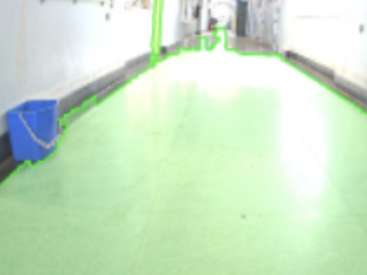

I'm a Project Associate at the **Indian Institute of Science (IISc), Bengaluru**, in Prof. Prathosh A.P.'s Representation Learning Lab.

My research interests are visual representations for spatial and temporal understanding of the physical world, and how multimodal models use that information for reasoning and prediction. At IISc, I work on segmentation and spatial reasoning with multimodal models.

I graduated from **IIT Madras** with a dual degree in Mechanical and Computational Engineering, and previously worked as a software developer.

<!-- Selected Research goes here: two entries, each with one figure, 80–120 words, a contribution sentence, collaborators/adviser and status. -->

## Selected Projects

  
  

    
<strong>Monocular Path Perception for Autonomous Navigation</strong> · 2022

    
Detected the drivable floor from a single RGB image using monocular depth, superpixels and region merging, for robots without a depth sensor. Undergraduate research with Dr. P.V. Manivannan, IIT Madras.

    
<a href="https://github.com/sohinidutta11/ground-plane-estimation">code</a>

  

