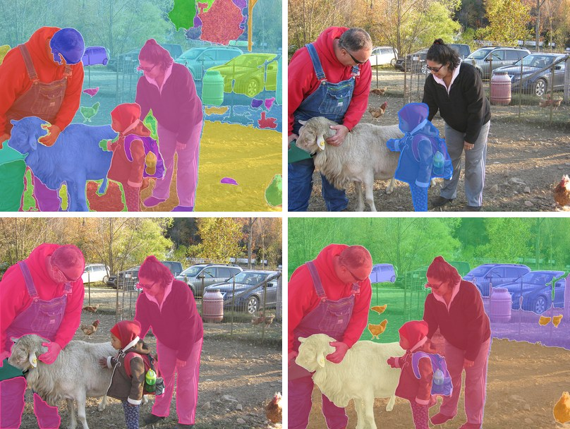
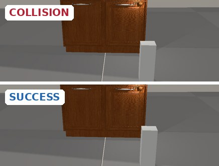

## Papers & Preprints

  
  

    
<a href="https://arxiv.org/abs/2611.33842">SPiXSeg: Rethinking MLLM-based Image Segmentation as Superpixel Classification</a>

    
Piyush Tiwary, <strong>Sohini Dutta</strong>, Prathosh A. P.

    
<em>arXiv preprint</em>, 2026

    
<a href="https://arxiv.org/abs/2611.33842">arXiv</a>

    
One set of superpixels per image, reused for referring, generalized referring and semantic segmentation.

  

  
  

    
ArtiCollision: Can Multimodal LLMs Predict the Consequences of Articulated Motion?

    
<strong>Sohini Dutta</strong>, Prathosh A. P.

    
<em>Ongoing research</em>, 2026

    
Can multimodal LLMs predict, from one image, whether opening a door or drawer will hit something?

  

## Earlier Projects

  
  

    
<a href="https://github.com/sohinidutta11/ground-plane-estimation">Monocular Path Perception for Autonomous Navigation</a>

    
<strong>Sohini Dutta</strong>, advised by Dr. P. V. Manivannan

    
<em>Undergraduate research, IIT Madras</em>, 2022

    
<a href="https://github.com/sohinidutta11/ground-plane-estimation">code</a>

    
Drivable-floor detection from a single RGB image, for robots without a depth sensor.

  

