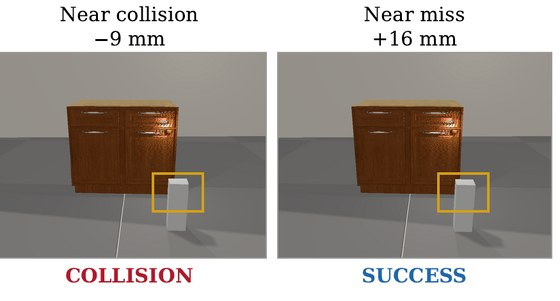
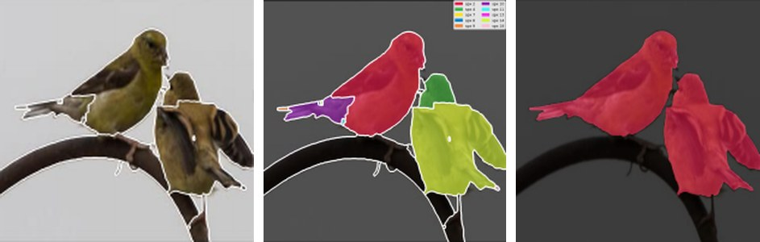
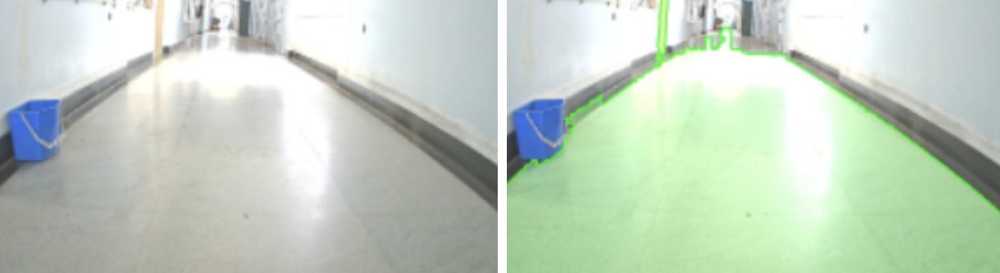

## Current Research

  
  

    
<strong>ArtiCollision: Can Multimodal LLMs Predict the Consequences of Articulated Motion?</strong>

    
Sohini Dutta, Prathosh A. P. · Ongoing research

    
Can multimodal LLMs predict whether an articulated object will collide with its surroundings from a single image and an action? I study this using controlled simulated scenes that separate sensitivity to collision geometry from simpler visual cues.

    
<em>My role:</em> I initiated and lead the project, built the simulation pipeline, and run the training and diagnostic experiments.

    
<a href="https://drive.google.com/file/d/1os2fuhWqmc05iWVTzoiSSeA96v0qo9xY/view?usp=sharing">Manuscript (PDF)</a>

  

  
  

    
<strong>SPiXSeg: Segmenting Images by Selecting Regions with Multimodal LLMs</strong>

    
Piyush Tiwary, Sohini Dutta, Prathosh A. P. · Manuscript in preparation

    
SPiXSeg segments images with a multimodal LLM by working with image regions instead of patches. The image is divided into superpixels that follow object boundaries, and the model selects the regions belonging to each answer directly from its hidden representations, so masks are recovered at full resolution. The same regions serve different segmentation tasks.

    
<em>My role:</em> I co-designed and built the mask-based positional encoding for regions, contributed geometry-aware pooling, and built the training and evaluation pipeline.

    
<a href="https://drive.google.com/file/d/1wdgOCyRm_HXQ90b4Y-iGfFPqKJEKutkw/view">Earlier version (PDF)</a>

  

## Previous Research

  
  

    
<strong>Monocular Path Perception for Autonomous Navigation</strong>

    
Undergraduate research · IIT Madras · Dr. P. V. Manivannan · 2022

    
Detected the drivable floor from a single RGB image using monocular depth, superpixels and region merging, for robots without a depth sensor.

    
<a href="https://github.com/sohinidutta11/ground-plane-estimation">Code</a>

  

